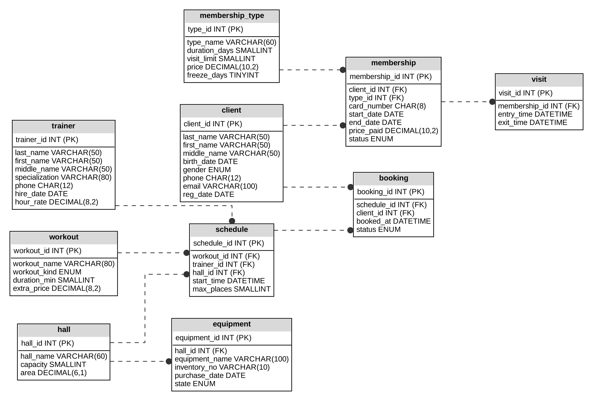

# База данных фитнес-клуба (MySQL 8.0)

Учебный проект по дисциплине «Базы данных» (РЭУ им. Г. В. Плеханова, направление «Информационные системы и технологии»).
Проект выполнен по методическим указаниям кафедры; при подготовке использовалась помощь ИИ-ассистента (Claude).

## Что внутри

Реляционная база данных для фитнес-клуба: клиенты, абонементы и их тарифы, тренеры, залы, оборудование, расписание групповых занятий, записи на занятия и учёт посещений.

- **10 таблиц**: `membership_type`, `client`, `membership`, `trainer`, `hall`, `equipment`, `workout`, `schedule`, `booking`, `visit`
- Первичные и внешние ключи, `UNIQUE`, `CHECK`, индексы
- **2 представления** (`v_schedule_full`, `v_active_membership`)
- **3 триггера**: автоматический расчёт даты окончания и цены абонемента, контроль прохода по абонементу и лимита посещений, контроль свободных мест при записи на занятие
- **2 хранимые процедуры**: заморозка абонемента (`sp_freeze_membership`), закрытие просроченных (`sp_close_expired`)
- **7 типов запросов**: соединение через `WHERE`, `INNER JOIN`, `CASE`, `GROUP BY` + `HAVING`, `LEFT JOIN`, вложенный подзапрос, представление
- Тестовые данные: около 100 строк

## ER-диаграмма



## Как запустить

Нужен MySQL 8.0 (или MySQL Workbench).

**Через консоль:**
```bash
mysql -u root -p < fitness_club.sql
mysql -u root -p fitness_club < queries.sql
```

**Через MySQL Workbench:** `File → Open SQL Script` → выбрать `fitness_club.sql` → выполнить (молния) → затем так же `queries.sql`.

> В `queries.sql` четыре команды помечены `ОШИБКА` — они специально нарушают правила, чтобы показать, что триггеры и процедуры работают.

## Структура репозитория

| Файл | Назначение |
|------|-----------|
| `fitness_club.sql` | полный скрипт: создание таблиц, данные, представления, триггеры, процедуры |
| `queries.sql` | запросы и проверка триггеров/процедур |
| `sql/` | тот же скрипт, разбитый на части (DDL, данные, триггеры) |
| `docs/er-diagram.png` | ER-диаграмма |
| `docs/report.pdf` | пояснительная записка (описание предметной области, модель, результаты запросов) |
